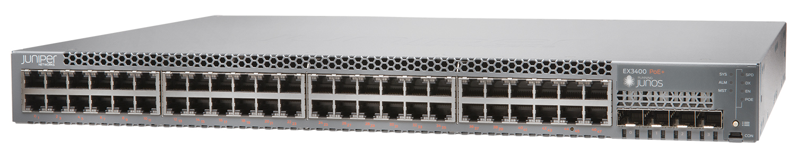
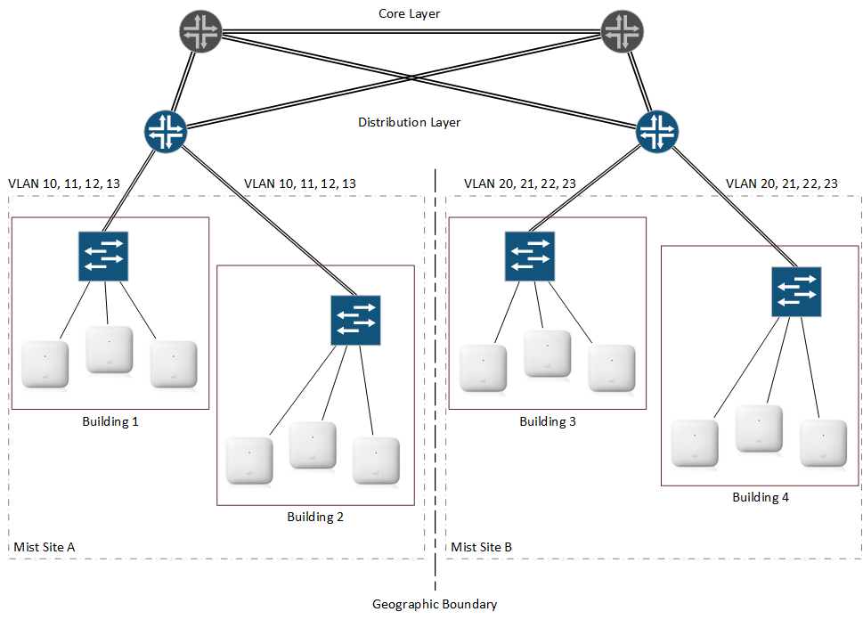
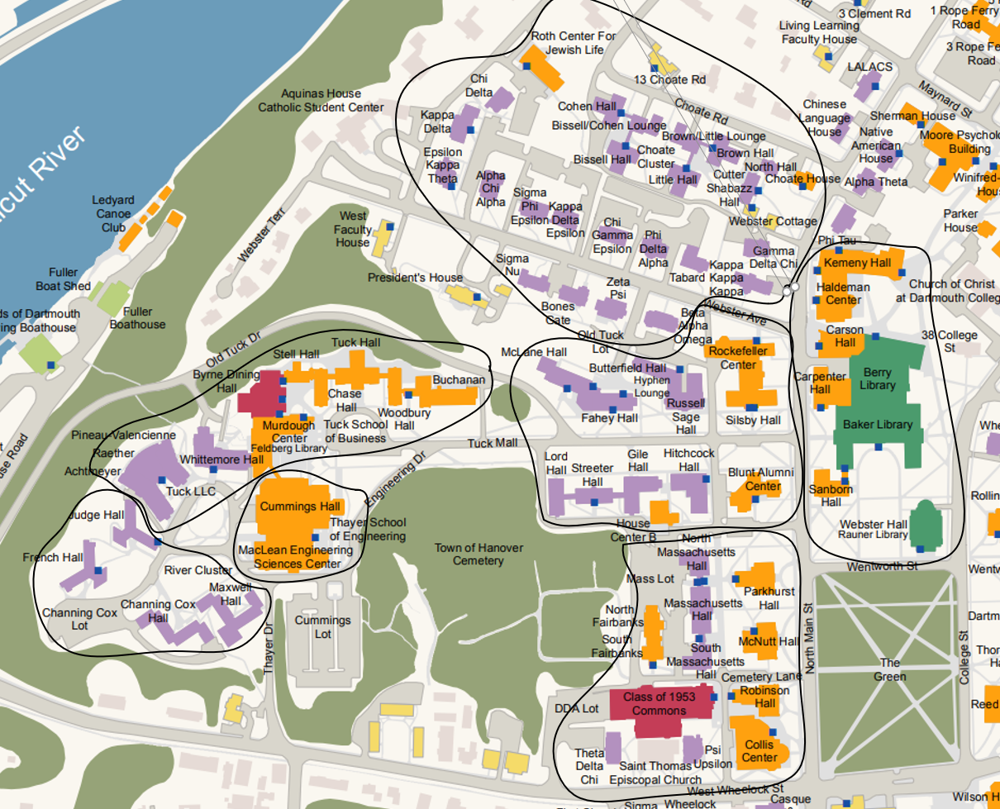

My colleagues and I often get asked the same several questions regarding our decision at “A College” to choose [Mist](http://www.mist.com) as our WiFi vendor and [Juniper](http://www.juniper.com) as our switching/routing vendor. In this series of posts, I will be sharing my answers to those questions.

### How does it work without a controller?

I’m going to draw on my experience with Cisco WLAN technology and reference designs since many of you are already familiar with those concepts and terminology. The short version is that Mist APs, without Mist Edge at least, function just like Cisco APs do in FlexConnect or H-REAP mode. WLAN client traffic is offloaded from the AP to the switch and is forwarded through the network from there. Client traffic does not get encapsulated or forwarded to a central controller – it appears as though the wireless clients are wired to the local switch.

In the most basic sense, we are using the common 3-Layer network architecture. (Posts about our endeavors into overlay/underlay campus architecture will come in the future!) Core routers connect to Distribution Routers, and Distribution routers to building Edge Switches. Our current choice of edge switch is the [Juniper EX3400-48P](https://www.juniper.net/us/en/products-services/switching/ex-series/ex3400/), a powerful multi-layer switch with 48x 1G PoE+ ports, 4x 1/10G SFP+ cages, and 2x 40G QSFP+ cages to be used for stacking multiple switches in a Virtual Chassis or for even higher-speed uplinks. (A Virtual Chassis is similar to a Cisco StackWise stack.) For buildings where we will be deploying the Mist AP43 and WiFi 6 in high-density, we are evaluating the use of the [Juniper EX4300M](https://www.juniper.net/us/en/products-services/switching/ex-series/ex4300m/) series of switches which provide mGig ports and 802.3bt for over 90W of PoE power.

Juniper EX3400-48P

One of my major issues with our legacy Cisco WLAN infrastructure is the controller. Even when deployed in HA with a standby controller, or when using the Primary/Secondary/Tertiary controller feature in the AP configs, any problem with the controller is noticed by the end users. All the end users, not just one or two, but an entire campus’ worth of users.

I’ve worked extensively with Cisco TAC over the past couple of years trying to squash some bugs that keep crawling up. Not just the usual little cosmetic ones, but big ones involving [memory leaks](https://bst.cloudapps.cisco.com/bugsearch/bug/CSCvp35686), [non-beaconing radios](https://bst.cloudapps.cisco.com/bugsearch/bug/CSCvn49888), and lots of unhappy users. In lieu of a proper workaround, or better yet a proper fix, I’ve written up some scripts which at least keep the system on it’s feet. (I know I’ve promised a few of you that I’d share these… only so many hours in a day.) They SSH into the controllers and APs periodically (every 15 minutes…), scrape the various logs for some telltale signs of the errors, and give the system a kick. I end up reloading about a dozen APs every day and failing over my controllers a couple of times a week. That seems to have kept the number of tickets in my bucket to a minimum, but I know that the users out there are still pretty unhappy when they randomly get kicked off the WLAN.

So, anyway, enough about Cisco and back to Mist… Look at the diagram below.

It’s your typical reference design, not too scary, right? The campus has been wired up for many many years. Fiber optic cable and pathway went into the ground back when daisy-chaining and ring topology were popular. Obviously, nowadays, that’s a less than ideal design. However, because of that physical infrastructure, we ended up with about 2 dozen distribution routers around campus – often one per cluster of buildings. That actually translated quite nicely into Mist’s Sites concept. A Mist Site, at a wireless layer, is a group of APs within which a client can seamlessly roam. 802.11r and OKC happen within a Mist Site, but not between sites. Roaming between sites requires a full 4-way handshake. We ended up grouping each of our fiber optic distribution routers and attached downstream buildings into a Mist Site. That way, we are relying on the geographic boundaries of the campus to designate the roaming boundaries on the WLAN. Aside from my dream of someday providing seamless WLAN roaming both indoors and outdoors on the campus and surrounding area, this works out pretty well. Users would not expect to maintain their Wi-Fi connection when walking across campus from one building to another. So, we leverage that lack-of-expectation, and break up the Mist Sites in those locations as well.

A section of the campus map showing some of the divisions into Mist Sites.  
Also, each area is a Fiber Optic hub/spoke zone and has a Layer 3 distribution router.

A user coming from, say, French Hall in the lower-left corner would never expect to maintain a Wi-Fi connection on their way to Berry Library on the right side of the map. We do not provide general outdoor Wi-Fi coverage (although that is slowly changing). Cell phone service in Hanover is usually pretty awful, but good enough that a phone call can be sustained or social media can be browsed while on said walk across campus.

OK, so Layer 1 (Mist Sites) break up at these convenient boundaries. How about Layers 2 and 3? Well, you may have noticed some VLAN IDs in my schematic above. All APs in buildings within a single Mist Site bridge WLAN users into the same VLAN and subnet. So, as long as Layer 1 “Site” boundaries aren’t crossed, Layer 2 and Layer 3 boundaries aren’t crossed either. A user remains on the same VLAN and subnet and gets to keep the same DHCP lease while within a Mist Site. Once that user roams into another site, however, they do a full 4-way handshake, try to Renew their DHCP lease from the previous site, get a DHCP NAK (because their old IP Address is not valid for the subnet they are now in) and then start the DHCP process over again with a DHCPDISCOVER. I haven’t timed this, but it’s not too bad for a normal user. I fully expect VoIP calls, Skype/Facetime/etc. to drop while inter-site roaming, however for typical browser traffic or for applications that maintain sessions at higher layers with a session cookie or similar, this drop and reconnect isn’t so bad. It’s still a roam which requires no user interaction.

There’s a lot more that is going into our Mist deployment, but hopefully this answers at least a few of the common questions. Keep on the lookout for more posts where I’ll answer questions such as:

- Why did you choose Mist over all the other brands?
- How does Mist work on Cisco Switches?
- I’m a student and my Wi-Fi sometimes sucks, why?
- What is eduroam and how does it work?
