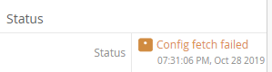
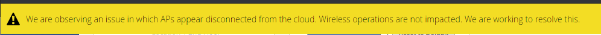

So, Mist’s cloud is having a bit of a hiccup right now. Not sure why, but I thought I’d share the user experience during this outage.

My 2 APs in my home lab are blinking Yellow-Green on their LED. This means “Connecting to Cloud”. Normally, this occurs when the APs first boot up from a power cycle or a software reboot and clears within 30 seconds.

The Mist Management UI is reporting both APs are Disconnected. However, they sent out a BLE beacon that indicated a bit more information. The APs head these beacons from each other and sent them up to the cloud in their “last breath”.

This directly corresponds to the Yellow-Green LED pattern I’m seeing above my head. If this were in a real environment, I wouldn’t have to get out of my chair or ask a user on the phone to interpret an LED pattern for me.

Now here’s the best part: the APs are still serving clients like nothing’s wrong! (Trust me, my wife in the room next to me streaming videos would let me know otherwise. A speedtest from my Android phone confirmed this.)

It gets better. In the time it took me to write this post and get to this paragraph (less than 10 minutes), Mist’s amazing support team identified the issue and send out an alert to the Management UI which popped up without me prompting for a refresh.

How did I confirm it’s a cloud outage and not something else? Well, I can get to everything else on the LAN and Internet via my WiFi connection. One of the first questions I asked the Mist team when I was learning about their product was “What I can monitor to determine if there’s a cloud issue?” http://ep-terminator.mistsys.net is the answer. Normally, it returns a simple JSON payload showing things like the version and uptime of their backend worker, but right now it’s giving me 503 and 404 errors. Also, api.mist.com is not responding. See <https://www.mist.com/documentation/ports-enable-firewall/> for more information.

But, the clients are none the wiser!

If it were a controller that was having trouble, I’d have 30,000 users telling me about it. #NeverLookingBack
