
Ever need to export cells to a CSV file? Tired of copy/pasting the cells you need into a new, blank sheet and exporting it as a CSV? Then being told you might lose some compatibility features, then needing to save-as a proper XLSX file again so you don’t lose sheets when saving again? Try this!

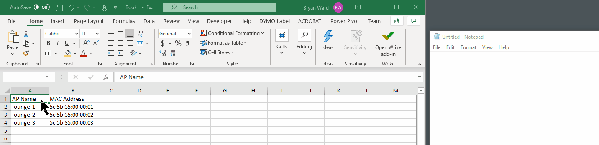

I assume you have Windows 10 and a modern version of Excel.

Right click on the Ribbon (toolbar) and select “Customize the Ribbon…”

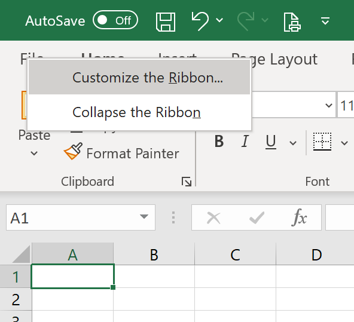

In the right-hand list, find Developer and make sure it’s checked. Click OK.

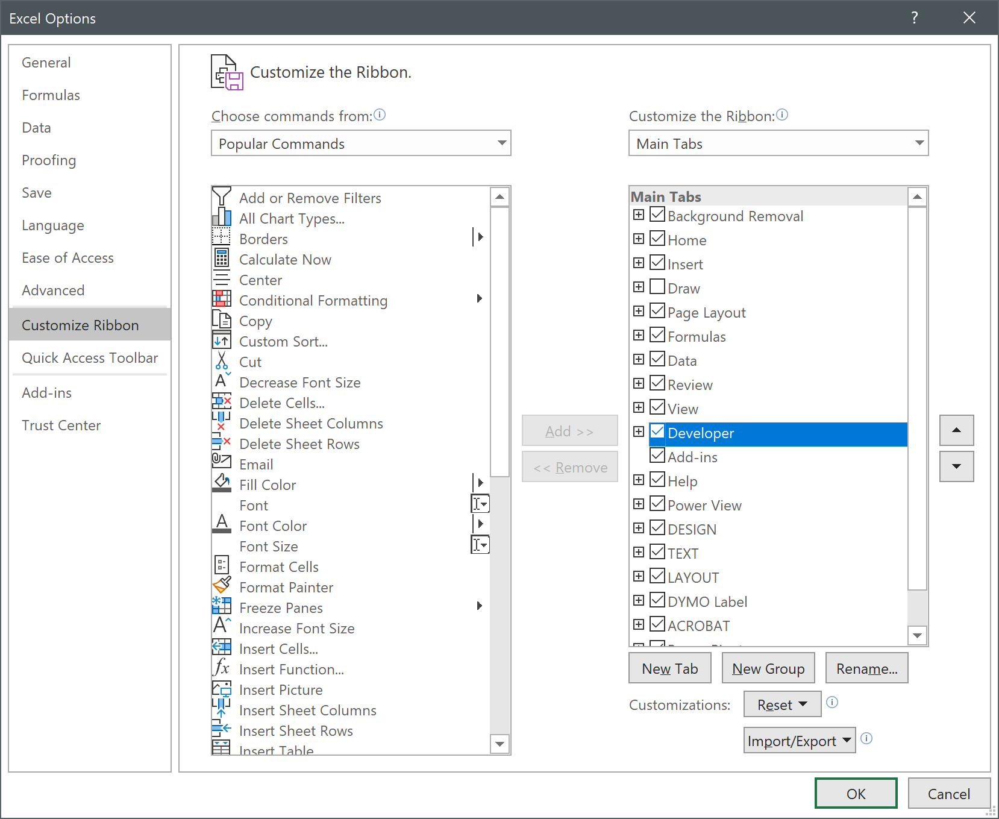

In the now visible Developer tab in the Ribbon, open Visual Basic, the first icon you see.

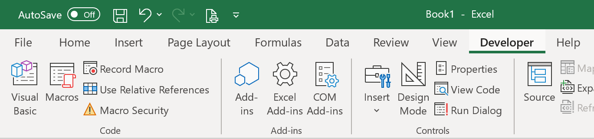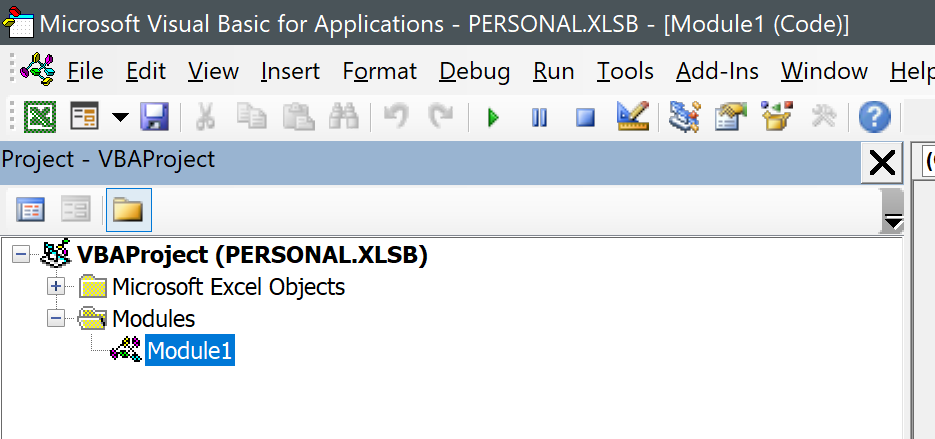

You should now see the Microsoft Visual Basic for Applications window appear.  You should also see a VBAProject (PERSONAL.XLSB) file loaded in the left-hand side of the editor.

If you don’t, switch back to Excel and create a new, blank Excel file.  Make no changes and save it as

C:\Users\*{{YOUR\_NAME\_HERE}}*\AppData\Roaming\Microsoft\Excel\XLSTART\PERSONAL.XLSB

Make sure the file type is “Excel Binary Workbook (\*.xlsb)” and the filename is ALL CAPS.

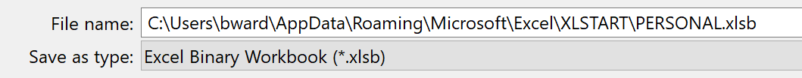

Now your editor should look similar to the following.


If your file does not have a Module1 file, right click on the VBAProject item and choose Insert->Module

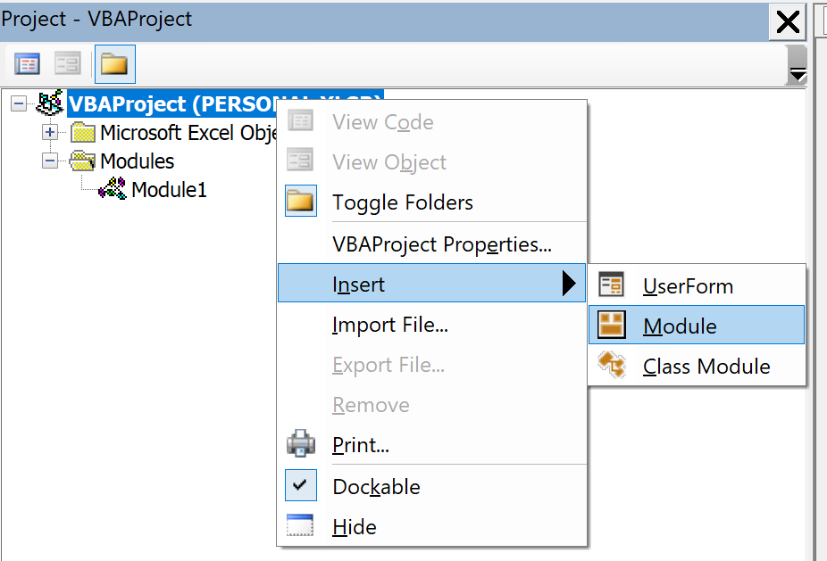

Double-Click Module1 to open it in the right-hand editor.

A new blank editor will look like the following:

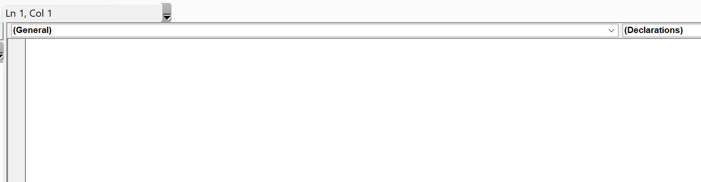

You might already have some code in the editor. If so, just paste the below code at the end of your existing file, or create a new Module to keep things separated.

```
Public Sub CopyAsCSV()
 'https://www.bryanward.net/wp/2020/01/17/excel-copy-as-csv/
 'https://answers.microsoft.com/en-us/mac/forum/macoffice2011-macexcel/copy-cells-and-paste-them-as-csv/b8a05dd8-4605-408a-a1da-9842c767745f?msgId=1aa0503e-d369-4d6b-909f-c8679ee44e3c&tab=AllReplies&page=1
 'https://www.excelforum.com/excel-programming-vba-macros/353942-how-do-i-reference-dataobject.html

Dim oDO As DataObject
Dim rArea As Range
Dim i As Long
Dim j As Long
Dim nCount As Long
Dim sTxt As String

Dim useQuotes As Boolean
useQuotes = True

If TypeOf Selection Is Range Then
    With Selection
        For Each rArea In .Areas
            With rArea
                If useQuotes Then
                    For i = 1 To .Rows.Count
                        For j = 1 To .Columns.Count
                            If j = 1 Then
                                sTxt = sTxt + Chr(34) + .Cells(i, j).Text + Chr(34)
                            Else
                                sTxt = sTxt + "," + Chr(34) + .Cells(i, j).Text + Chr(34)
                            End If
                            nCount = nCount + 1
                        Next j
                        sTxt = sTxt + vbCrLf
                    Next i
                Else
                    For i = 1 To .Rows.Count
                        For j = 1 To .Columns.Count
                            If j = 1 Then
                                sTxt = sTxt + .Cells(i, j).Text
                            Else
                                sTxt = sTxt + "," + .Cells(i, j).Text
                            End If
                            nCount = nCount + 1
                        Next j
                        sTxt = sTxt + vbCrLf
                    Next i
                End If
            End With
        Next rArea
    End With
    Set oDO = New DataObject
    oDO.SetText sTxt
    oDO.PutInClipboard
End If
End Sub
```

While you’re still here in the VBA editor, let’s make sure the MSForms 2.0 library is loaded. It wasn’t by default on my system and is required for this to work. Goto Tools>References… in the VBA Editor.

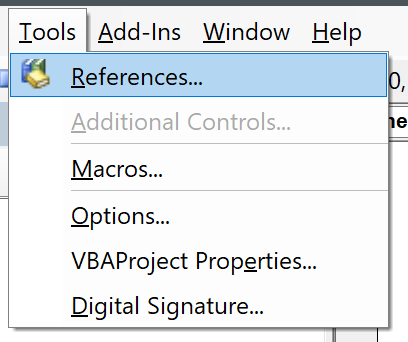

Click Browse… and then in the Add Reference dialog, open the file C:\Windows\System32\FM20.DLL . It should already be installed on your system.

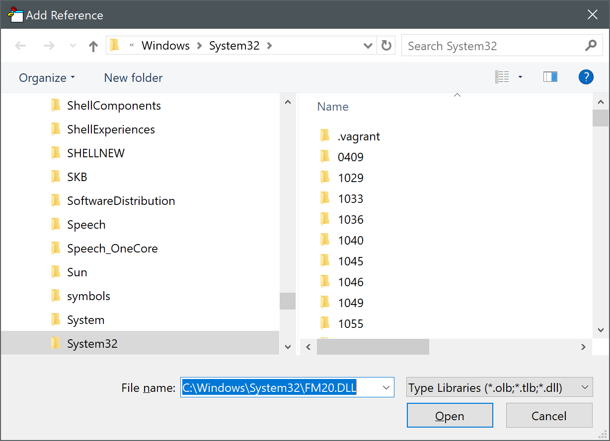

You should now see the Microsoft Forms 2.0 Object Library in the list. Make sure it’s checked and click OK.

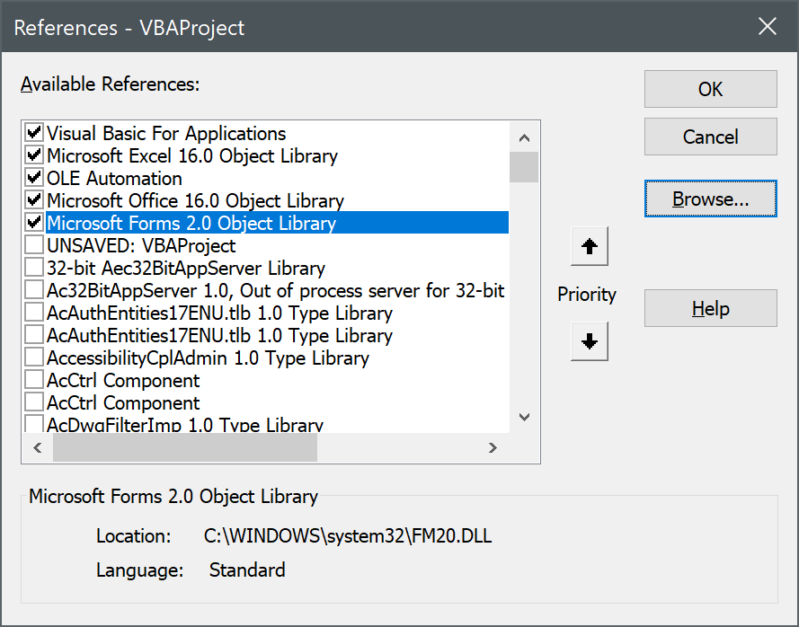

Save and Close the VBA Editor.

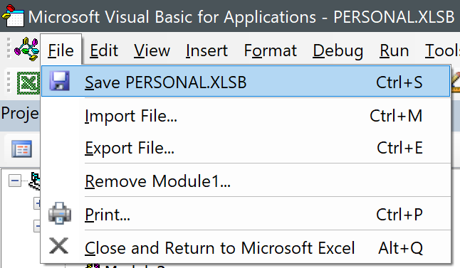

Get back into the Customize the Ribbon dialog.

Choose Macros from the “Choose commands from” list.

Select “PERSONAL.XLSB!CopyAsCSV”

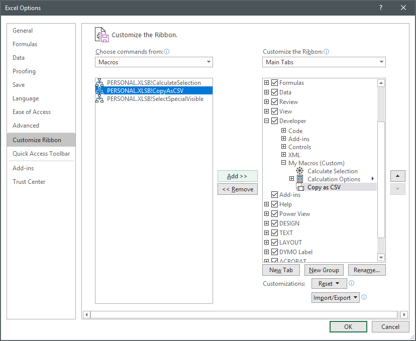

Then, browse in the right-hand list to where you want to place the new ribbon/toolbar command. I keep my macros under the Developer tab so as to not mess up any of the other default tabs. You can also create new tabs, groups, etc. by right-clicking in the right-hand list.

Click the Add >> button between the two lists.

Give the new button a more useful name and a pretty icon by selecting it in the right-hand list and clicking the Rename… button below the list.

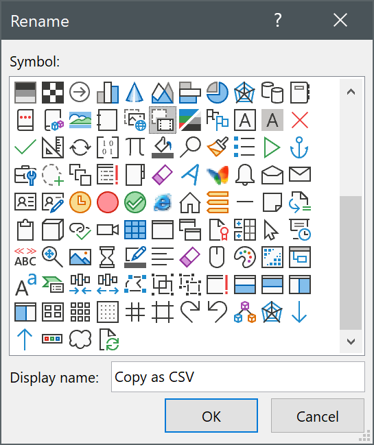

Click OK to exit the Rename dialog, and then OK again to exit the Customize the Ribbon dialog. Your new button should now be visible in the location you chose.

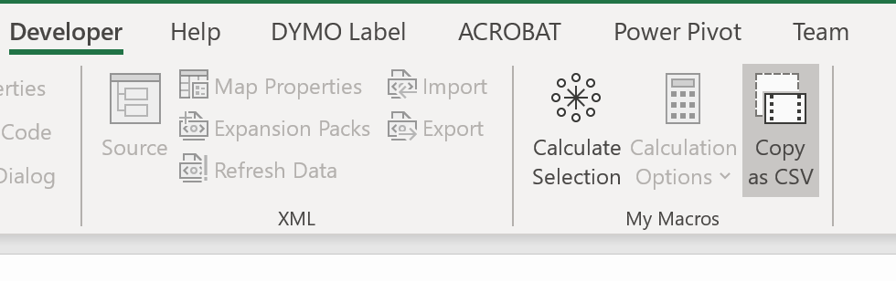

**Give it a shot!**


*Also, when did “Search with Bing…” get added to Notepad…*

Sources:

<https://answers.microsoft.com/en-us/mac/forum/macoffice2011-macexcel/copy-cells-and-paste-them-as-csv/b8a05dd8-4605-408a-a1da-9842c767745f?msgId=1aa0503e-d369-4d6b-909f-c8679ee44e3c&tab=AllReplies&page=1>

<https://www.excelforum.com/excel-programming-vba-macros/353942-how-do-i-reference-dataobject.html>

