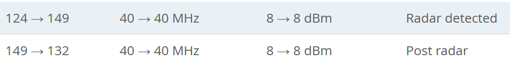

Mist APs seem to maintain their channel width upon detecting a DFS event. They do not narrow down to 20MHz. They also do not all jump to channel 36 upon such an event, they seem to pick a next-best channel.

