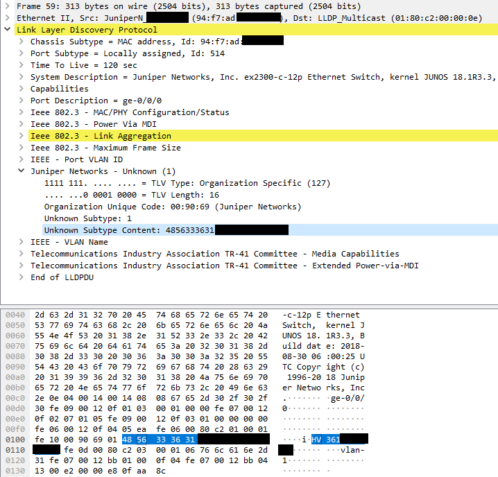

LLDP can send a lot of useful information. One thing I discovered was that Juniper switches send their chassis serial number as a vendor-specific TLV. Ok, maybe not the most exciting discovery, but since Wireshark can’t decode this (yet), I thought I’d share.



The “Unknown Subtype Content” is actually the chassis serial number, encoded as ASCII.

Using the `show lldp neighbors` command from a neighboring switch can properly decode this information, and results in the following payload of that TLV:

```
Organization Info  
OUI : Juniper Specific (0x009069)  
Subtype : Chassis Serial Type (1)  
Info : Juniper Slot Serial [HV361xxxxxxx]  
Index : 6
```
