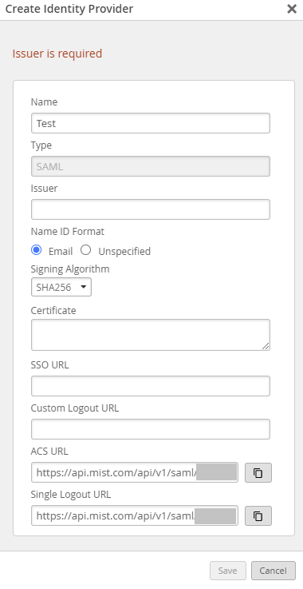
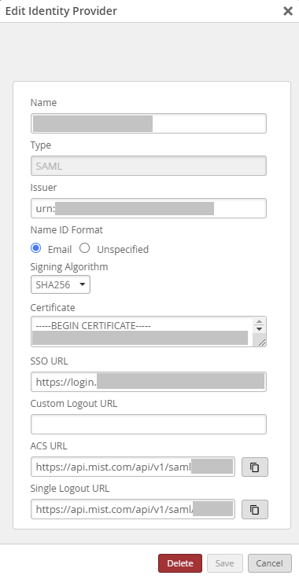
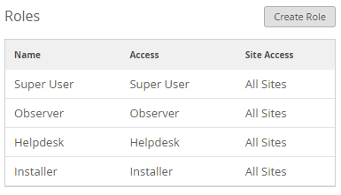
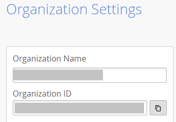
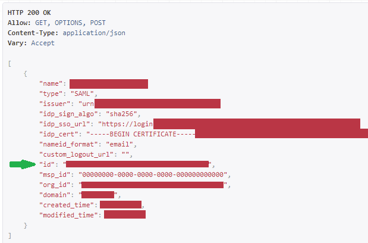
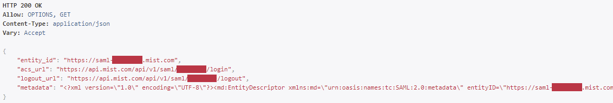
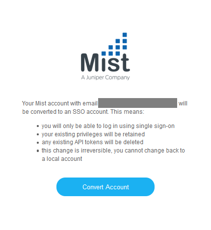
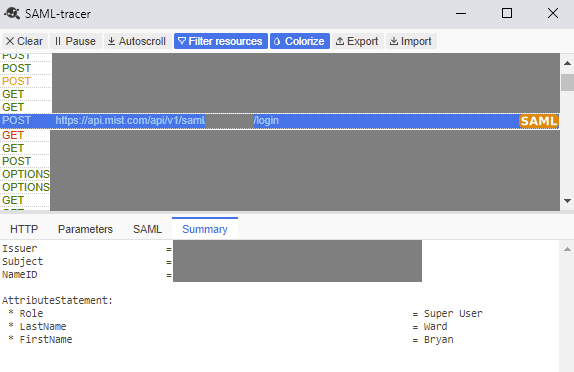

Single Sign On is one of those computing magic tricks where the magicians never reveal their secrets. Sometimes, us muggles are asked to perform works of sorcery and illusion and we have to put on a good show.

I recently tasked myself with setting up our Mist environment to work with our central SSO system. We were about to begin letting our helpdesk users into the Mist UI and I realized that there needed to be a better way to control access than the local accounts we had originally set up. Mist does support SAML out of the box, and I know our SSO solution supports SAML, so how hard could it be?


SSO is something best left to the “professionals”. Not because it’s a terribly difficult technology, but because it is so nuanced and comes with a long list of vocabulary words that the un-initiated (SAML pun intended), might not completely understand. Here’s a quick summary, and by no means are my definitions going to be the textbook-correct ones:

**SSO** – Single Sign On. System which lets users authenticate and be authorized to use other systems. Think of it like AAA for the application layer.  
**SAML** – Secure Authentication Markup Language. This is to SSO what JSON is to a good API.  
**IdP** – Identity Provider. The system which provides a method of authenticating user accounts.  
**SP** – Service Provider. The application you are trying to log in to.  
**Certificate** – The magical file of random numbers and letters which tells two systems to trust each other.  
**Metadata** – More magical information that IdP and SP systems use to learn about each other. Vaguely human-readable XML that has answers you’ll need.  
**Attribute** – Data that is communicated between an IdP and an SP other than the username. Things like First Name, Last Name, Department, etc.

So, how do we set this up for Mist? Well, Mist does provide some documentation: <https://www.mist.com/documentation/category/saml/> but it didn’t translate exactly to what our system is. (We are using [CAS](https://apereo.github.io/cas/), by the way.) Here’s how I did it:

1. Find out who your IdP system admin is. Become best friends with them. Buy them beer, or wine. Ask what their favorite color is. Or, just put a ticket in their queue and hope they respond. Tell them you’d like to setup a new service to use your organization’s SAML SSO system.
2. Goto Mist’s UI, Organization>Settings.
3. Find the “Single Sign-on” section, and click “Add IDP”. Put in a name here. It doesn’t matter what you call it. You can rename it later if you want.
4. Then, click the item you just added in the list in the UI and have a look:



You’ll notice a few things are already filled out for you – Name (which you just entered), Type (which is SAML), and the ACS URL and Single Logout URL. Everything else you need to figure out.

5. Once your IdP admin has gotten back to you, one of the first things you’ll need to ask is what your org’s Metadata is. They can provide this to you as an XML file they email you, or more commonly, as a URL you can goto in your browser. Something like https://login.example.com/some/long/url/here/metadata. When you open it, you’ll see some XML in your browser. The first line should read something like `<EntityDescriptor entityID="blahblahblahblah">`.  
   That blah blah blah part is actually important. And it’s going to be unique for your organization. If you’re familiar with certificates, then this is like the CN of a certificate. That entityID value goes into this Issuer field in the Mist UI. Some look like URLs, some are URNs – it just has to match what your IdP system uses. (<https://datatracker.ietf.org/doc/html/rfc3986#section-1.1.3> – in case you’re curious about the difference)
6. Next, you’ll want to scroll down a bit in the Metadata file. You’re looking for something that looks like a Base-64 encoded Certificate (block of random letters and numbers). In my case, it was in the <ds:X509Certificate> tag in the XML file. Paste that into the Mist UI’s Certificate field and add the “BEGIN CERTIFICATE” and “END CERTIFICATE” lines so that it looks like the below:

```
-----BEGIN CERTIFICATE-----
BLOCK OF RANDOM NUMBERS AND LETTERS HERE
-----END CERTIFICATE-----
```

The Signing Algorithm I left at the default of SHA256. This worked in my case, but if your certificates are using another method, you’ll need to change that. The IdP admin I was working with didn’t know what it was, so I think we just got lucky by picking SHA256. Fortunately, there’s not a long list to choose from, so you can quickly run through them all if you need to make a brute-force selection.

7. Then you’ll want to determine how your IdP provides usernames. Chances are you’ll want to keep the “Email” bubble selected – this indicates that your IdP sends usernames formatted like an email address “username@example.com” to the SP. Mist does allow “Unspecified” as an option, however I’m not sure it’s functional. Later on in the process, even if I chose Unspecified, Mist was still assuming the format was Email. That was OK for me as that was the format I needed to use (and you should probably use too).
8. You’ll also need the SSO URL from your IdP system. IdP systems often have a couple of options, and they have to do with how the login form data is sent to the IdP and how the browser needs to redirect you back to the application. I had URLs for options such as POST, Redirect, SOAP, and a couple of others. These URLs might also be present in your org’s Metadata file as well. I found them within the <SingleSignOnService …> tags in the XML. The Redirect one is what worked for me. I had originally chosen the POST one and then later had to change it to Redirect.
9. Last is the Custom Logout URL. You should probably leave this blank. SSO is good at signing users into systems, but not signing them out. Your SSO system probably has a URL for this – mine did – but as it was explained to me, it’s not worth using. Each SP caches a token from your IdP when you sign in, and it’s valid until the token expires (24 hours, 1 week, 30 days, or whatever your IdP admin had set it up to be). If you Sign Out of your IdP, that just means it’s not going to issue any more tokens on your behalf until you sign back in. Existing tokens are still valid at this point and there’s no good way to go back and invalidate them all after they’ve been issued.
10. So, at this point, your Mist UI should have fields filled in and look like:



11. Alright, now what about those ACS URL and Single Logout URL fields? Those are generated by Mist and are unique to your organization. (They’re unique to the IdP config in your organization, actually, as you can have multiple SSOs configured within Mist.) Provide them to your IdP admin – they’ll need this to configure the IdP backend to work with Mist.
12. Click Save and exit this config dialog. Next you’ll need to configure the Roles for when users login. The IdP not only authenticates users, but it also has a method to *authorize* users. The Roles in Mist are how we tell Mist what permissions to give to a user once they’ve logged in. I kept it pretty simple:



You may want to create more roles in your scenario. Say for local IT staff in a remote/branch office, you might want to give them Site Admin access. You’ll create a role for each site. (If you have the quintessential 500 sites, you can use the Mist API to create these roles too! The Mist API can be used to do everything we’ve done here! <https://api.mist.com/api/v1/docs/Org#sso-saml>)

These Roles will also be used in the IdP backend, so make sure you provide the Name of each role to your IdP admin. They are case-sensitive and spaces/punctuation must match as well. The IdP admin will need to program a bit of logic that maps, say an Active Directory Security Group, to each role. You’ll want to figure out if you have an existing AD Group that makes sense, or if you’ll need to create new ones specific for Mist. (You might already have an AD Group for your Helpdesk staff, for instance, but not one for your Wi-Fi Engineers.) You’ll want to document what the groups being used are, so that in the future when you have to add/remove users’ access to Mist you know what groups to modify. The code that our IdP admin had to program looked something like:  
`return (attributes['memberof'].contains('CN=Network Engineers,OU=IT Department,OU=Security Groups,DC=domain,DC=example,DC=com'))?'Super User':''`  
That essentially says, if the user is a member of the Network Engineers group in AD, then pass the role “Super User” back to Mist, otherwise return a null string (”) which indicates that the users is not authorized to access the Mist system. Obviously, the logic needs to be a bit more complex if you have more Roles to assign, and every IdP system handles this in a different way.

13. Your IdP admin has likely been asking you for more information along the way. Mist also does have it’s own Metadata, and you’ll need to provide that to your IdP admin as well. Getting it is a little tricky, however… Perhaps Mist could simply put a link to it in the GUI? To get the metadata, you first need to get the SSO ID for the config you’ve created. To get the SSO ID, you’ll first need to get your Mist Org ID. If you’ve ever used the Mist API, you probably have this saved somewhere already. Getting the Mist Org ID is not too bad – it’s actually right there on the Organization>Settings screen we’ve been on this whole time. They even have a button to copy it to your clipboard!



But first, open a new browser tab and paste the following URL into it: `https://api.mist.com/api/v1/orgs/:org_id/ssos`  
Then, replace the `:org_id` bit with the Organization ID from the Mist UI so it looks something like `https://api.mist.com/api/v1/orgs/12345678-abcd-1234-5678-1234567890ab/ssos` and browse to that page. You’ll get to something that looks like the following:



That `"id"` value is what you’re after. Open another browser tab and paste the following URL into it: `https://api.mist.com/api/v1/orgs/:org_id/ssos/:sso_id` . Replace the `:org_id` bit again with your Organization ID, and then also replace the `:sso_id` bit with the `"id"` field we just discovered.

It should look something like  
`https://api.mist.com/api/v1/orgs/12345678-abcd-1234-5678-1234567890ab/ssos/11111111-2222-3333-4444-555555555555/metadata` and when you browse to it, you should get:



The `"acs_url"` and `"logout_url"` are the same as you saw in the GUI. The `"entity_id"` and `"metadata"` lines are the new information we’re after. Provide them to your IdP admin. But, here’s a big gotcha! The `entity_id` displayed here is actually wrong! You’ll need to provide an `entity ID` to your IdP admin that looks more like: `https://api.mist.com/api/v1/saml/REDACTED/login` With the REDACTED part matching the part that is unique to your configuration in Mist. So, if the /metadata page showed:  
`"entity_id": "https://saml-12345678.mist.com"` you’ll want to actually use the entity ID `https://api.mist.com/api/v1/saml/12345678/login` . Strange? Yes. Undocumented? Also yes. Fortunately Mist Support knows what they’re doing and was able to tell me about this while I was setting SSO up.

Your IdP admin probably also wants the `"metadata"` line as well. You should see that it is just XML in there.  
You IdP admin will also want to know what Attributes to send to the Mist SP. You should provide “FirstName”, “LastName”, and “Role” in addition to the “NameID” formatted as an email address.

14. Okay, phew. Assuming everything went well, and your IdP admin was able to keep up and get the backend programmed, it’s now time to try it out, right? Well, yes, but I have one more thing to explain first.  
    The Mist accounts you’ve been using to log into Mist until now have been “local” accounts within Mist. Mist maintains a list of usernames, email addresses, first/last names, roles, and passwords – as visible from the Organization>Administrators page of the GUI. The password you’ve been using may or may not be the same as the password you use to log into your SSO system right now (Security Tip – it should have been different). Accounts in Mist that use the same email address can be either a local Mist account, *or* an SSO account. When you login to Mist using SSO and the IdP provides the same email address as exists as a local account, Mist will convert the account to be SSO only. That’s probably what you want at the end of the day, but since SSO never ever works on the first try, you’ll want to create yourself another local account (or have a colleague with Super Admin access to Mist standing by in case you lock yourself out). Use an email alias, plus addressing if your email system supports it, or create an Outlook group for yourself – somehow create another “backdoor” account within Mist that won’t be converted to SSO when you proceed.
15. Okay, I lied. I do have another thing to explain as well. There are two ways to use SSO to login to a service. First is an SP-Initiated login. This is when you start at the web page of the service you want to log into (manage.mist.com, for example) and you enter your SSO username there. Then, you get redirected to your SSO system to complete the login, and then get redirected back to the service. The second is an IdP-Initated login. This is less commonly used. This is when you start at your SSO system, log in there, and then you pick the service you wish to access. Some organizations use this as part of their Intranet homepage – you log in and then you can click links or icons on a web page for various applications you can access. Not all organizations have this Intranet page, but your IdP admin should know what an IdP-Initated login is and should be able to tell you how to do one for Mist. In my case, I was given a big long URL like `https://login.example.com/some/long/url/here/Unsolicited/SSO?providerId=https://api.mist.com/api/v1/saml/12345678/login` . Going to that URL (in a private browser tab!) brought my to my SSO login page, and then redirected me to Mist after I logged in.
16. In order to convert a local account in Mist to use SSO, or to have Mist learn about a new user that is authorized via SSO, you need to do an IdP-Initiated login. Use that IdP-Initated login method that your IdP admin should know about.  
    When converting an existing local account to an SSO one, Mist will give you a warning upon logging in:



The scary bit here for me is that “any existing API tokens will be deleted”. Since I’m a heavy user of the Mist API, I needed to make sure that my tokens would remain active. SSO users in Mist cannot get user-specific tokens for using the API. Instead, you’ll need to keep a local account in Mist which holds tokens, or better yet, use [Org-Specific Tokens](https://api.mist.com/api/v1/docs/Org#api-token) for your scripts/apps that you’ve made. Click convert, and you’ll be logged into Mist with your shiny new SSO account. Not much will look different.

SSO Accounts do not appear in the Organization>Administrators page in Mist (or the equivalent API), but they will show up in Audit Logs. If you want to know who has what access to Mist, you’ll need to look in your Active Directory (or similar) that your IdP refers to.

**Pro Tip!** That IdP-Initated login URL is pretty hard to remember, right? Ask your load balancer admin to create a 301 Redirect for you! Make a DNS name like mist-login.example.com and have it point to your company’s load balancer. Then, the load balancer can respond with an HTTP 301 Redirect and have a browser go to the long, complicated URL instead! (A CNAME in DNS won’t work, as we need to not only redirect the domain name, but also the path and querystring. CNAMEs only redirect the domain name, nothing else.)

After an account has successfully logged into Mist once using an IdP-Initated login, you can do SP-Initiated logins from https://manage.mist.com/ if you choose. You can also keep doing IdP-Initated logins too. Personally, that’s what I’ve been doing as I’m not prompted to enter my email address into Mist’s login page if I’ve already signed into SSO for the day. You should, however, check that the SP-Initiated login does work while you’ve still got your IdP admin working with you. Again, private browser tabs are your friend here.

That’s about it. SSO is not trivial to setup, and Mist’s implementation of it is a bit arcane, but it’s something that you’ll have to do once and never touch it again.

**Pro Tip!** I’ll also mention the browser plugin SAML Tracer (Firefox: <https://addons.mozilla.org/en-US/firefox/addon/saml-tracer/>, Chrome: <https://chrome.google.com/webstore/detail/saml-tracer/mpdajninpobndbfcldcmbpnnbhibjmch?hl=en>). It’s great for debugging SSO processes. Basically, install this plugin, open it up, and start logging into something. It will sniff the traffic between the IdP and SP and display it in a nice format for you. Messages identified as containing SAML are highlighted and decoded



Another **Pro Tip!** Mist’s API will provide information on failures and error messages that the SP backend is logging, which could be helpful to you ~~if~~ when you get stuck setting this up. `https://api.mist.com/api/v1/orgs/12345678-abcd-1234-5678-1234567890ab/ssos/11111111-2222-3333-4444-555555555555/failures` is the URL to use. It’s the same as the /metadata URL from earlier, but it’s /failures instead. I don’t know how far back these logs are kept, but you probably won’t care much about them after the initial setup of SSO.

Because I don’t say it enough, Mist Support is awesome. If you get into trouble configuring SSO, you should reach out to them. They can sort you out in no time.
