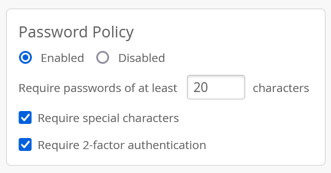
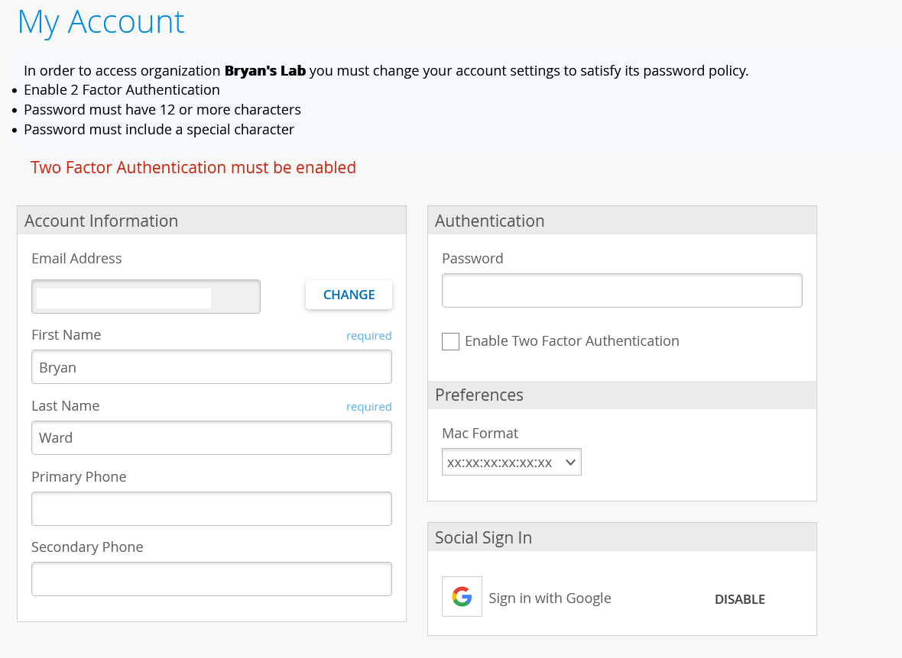

Enabling a password or 2FA policy on Mist is quite a painless change, however there is a gotcha I encountered.

To enable a password policy, goto Organization>Settings. Find the section labeled Password Policy. Check the boxes and call it a day.

This takes effect immediately. Users who do not have passwords that meet the policy, or who do not have 2FA setup for their account, will be blocked from logging into the GUI until they make the necessary changes. Currently logged-in users will not be logged out. These users will be redirected to the following screen at their next login:

The user should then enter a new password and check the “Enable Two Factor Authentication” box on the upper right, as needed.

The next screen will show a QR code with which to enroll a 2FA authenticator. I used Google Authenticator, but any 2FA app should work. The user will be prompted to enter the code from the 2FA app to verify, and then will be redirected to the login screen.

OK, it’s pretty easy, so then why am I writing about it?

Use of API tokens are considered a login. If a user has an API token under their account (i.e. not an org-level/scoped API token, which is now preferred), then use of that token will result in a `403 Org Password Policy Not Met` error, causing scripts or pipelines to fail. If you do not know what type of API token you are using (user or org), you can check the following endpoints:

Show User API Tokens: <https://api.mist.com/api/v1/self/apitokens>

Show Org API Tokens: <https://api.mist.com/api/v1/orgs/:org_id/apitokens>
