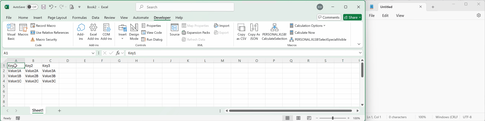

A new twist on my existing [Copy As CSV](https://bryanward.net/wp/2020/01/17/excel-copy-as-csv/) macro, this code will copy the selected cells in an Excel spreadsheet as a JSON document to your clipboard.

Install this in Excel using the same instructions as provided in my [Copy as CSV](https://bryanward.net/wp/2020/01/17/excel-copy-as-csv/) post, but just use the below code instead. It will return a list of dicts, with keys based on the first row of the selected cells. Each row in the selection becomes an item in the list. All values are treated as strings for simplicity.
