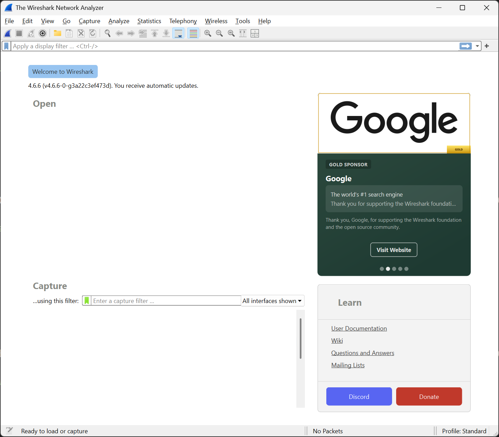
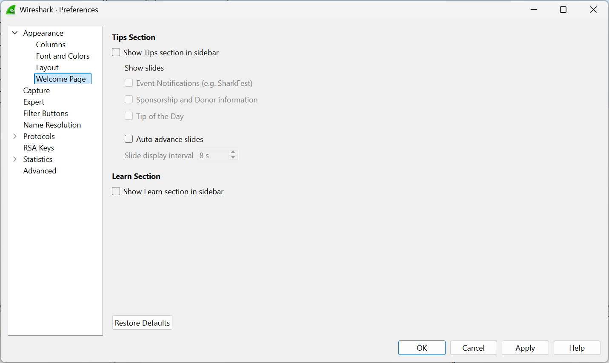

It’s a sad day. There are now ads in Wireshark. 🙁 Here’s how to remove them.

Needless to say, I was shocked when I saw this new “feature”. Sure, it might be nice to have handy links to documentation and events like Sharkfest, but I definitely don’t want them inside the app I use daily for troubleshooting purposes.



## Update

(Thanks Anders for pointing this out!)

In the Edit>Preferences section, there is now an Appearance>Welcome Page section. You can go there and simply uncheck everything.



## Original post

You’ll need to edit the preferences file for your Wireshark installation. On Windows, you can find this at `%APPDATA%\Wireshark\preferences`. On Mac/Linux, you can find this at `~/.config/wireshark/preferences`.

Some other posts about this topic say to edit the `recent_common` file, however that file gets regenerated every time Wireshark exits. You need to edit the `preferences` file instead. This file will get overwritten any time you change the preferences in the app, and the changes we’re about to make might get erased, but that’s much less often an occurrence than just running and exiting Wireshark.

Make sure Wireshark is not presently running before opening the preferences file. At the end of the file, add these lines:

```
gui.welcome_page.sidebar.learn_visible: false
gui.welcome_page.sidebar.tips_visible: false
gui.welcome_page.sidebar.tips_events: false
gui.welcome_page.sidebar.tips_sponsorship: false
gui.welcome_page.sidebar.tips_tips: false
gui.welcome_page.sidebar.tips_interval: 0
```

And save the file.

Remember to do this on any computer you use Wireshark on.
